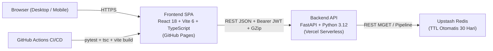

# Portal Instruktur LBT PII

<p>
  <a href="https://nuclear-boy.github.io/portal-instruktur/"></a>
  
  
  
  
  
  
</p>

**Portal Instruktur Leadership Basic Training (LBT) Pelajar Islam Indonesia** adalah aplikasi web full-stack terpusat untuk manajemen operasional training kader: pengelolaan multi-lokal, pendataan peserta, jadwal 32 materi terintegrasi, kanvas **Sosiogram RELI** interaktif, penilaian pemateri 12 aspek mobile-first, monitoring performa peserta & pemateri, serta ekspor laporan HTML/PDF/CSV siap cetak.

> **Live App:** https://nuclear-boy.github.io/portal-instruktur/

---

## Ringkasan Masalah & Solusi

Sebelumnya, tim instruktur LBT mengelola presensi, sosiogram ruang kelas, penilaian peserta (R/E/L/I), serta lembar evaluasi pemateri secara terpisah menggunakan file statis dan spreadsheet manual. Hal ini memicu duplikasi data, risiko kehilangan catatan lapangan saat koneksi tidak stabil, serta lamanya proses rekapitulasi laporan akhir.

Portal ini menyatukan seluruh alur kerja tim instruktur ke dalam satu sistem berbasis peran (**RBAC 4 Peran**) yang ringan, cepat di perangkat mobile, dan aman untuk operasional lapangan.

---

## Arsitektur Sistem



| Lapisan | Teknologi | Hosting / Peran |
|---|---|---|
| **Frontend** | React 18, TypeScript, Vite 6, React Router (`HashRouter`), Recharts, jsPDF + AutoTable | GitHub Pages (CI/CD via GitHub Actions) |
| **Backend** | FastAPI, Pydantic v2, PyJWT, bcrypt, httpx, GZipMiddleware | Vercel Python Serverless (`Root Directory: backend/`) |
| **Database** | Upstash Redis REST API dengan TTL otomatis + akun admin permanen | Upstash Cloud |

---

## Fitur Utama

### 1. Kontrol Akses 4 Peran (RBAC) & Isolasi Lokal
| Peran | Kode | Cakupan & Kewenangan |
|---|---|---|
| **Admin** | `admin` | Mengelola akun Koordinator Tim, memantau status login seluruh akun; tidak memiliki akses ke data operasional peserta/sesi |
| **Koordinator Tim** | `koordinator` | Akses penuh lintas lokal: manajemen lokal (cascade delete), akun Inlok & Observer, peserta (termasuk impor massal CSV/Excel), jadwal materi, pertemuan, pemateri, Monitoring Peserta, **Monitoring Pemateri**, serta Laporan |
| **Instruktur Lokal** | `instruktur_lokal` | Akses baca (read-only) untuk lokalnya: Dashboard progres, Pertemuan, Monitoring Peserta, Detail Peserta, **Monitoring Pemateri**, Laporan/PDF, dan Profil |
| **Observer** | `observer` | Input data lapangan khusus lokalnya: kanvas Sosiogram RELI, nilai R/E/L/I, absensi, durasi aktual sesi, catatan peserta, dan lembar Penilaian Pemateri |

### 2. Kanvas Sosiogram RELI & Analitik Komunikasi
- Denah ruang interaktif (huruf U, dua kolom, grid) dengan drag/resize kursi & kotak pemateri, penautan otomatis kursi ke peserta, serta mode kabel komunikasi dengan pelacakan frekuensi keluar/masuk.
- Input skor R/E/L/I (`0–10`) yang tervalidasi di frontend & backend, tally cepat `4×28`, catatan per peserta, **penyimpanan draf offline otomatis (`localStorage`)**, dan optimistic locking (`version`) untuk mencegah konflik simpan bersamaan.
- Visualisasi **Heatmap Komunikasi** dengan algoritma inisial cerdas anti-tabrakan (*smart unique initials*) + legenda otomatis.

### 3. Penilaian Pemateri 12 Aspek & Monitoring Pemateri
- **Form Mobile-First**: Tombol skor segmented `1–5` yang dikelompokkan ke 3 dimensi (**Penampilan**, **Bahasa**, **Materi** — 12 sub-aspek), pengisian cepat per kelompok, deteksi duplikat otomatis, quick chips catatan/rekomendasi, serta draf offline.
- **Halaman Monitoring Pemateri (`/monitoring-pemateri`)**: Khusus untuk **Koordinator Tim** dan **Instruktur Lokal** — menampilkan 5 KPI utama, perbandingan 12 sub-aspek (terlemah → terkuat), peringkat pemateri lengkap dengan **korelasi interaksi forum dari Sosiogram**, tren performa lintas sesi, serta pelacakan sesi yang belum dinilai.
- **Auto-seed Pemateri & 32 Materi**: Daftar 17 pemateri resmi otomatis ter-seed sekali pakai saat pertama diakses, dilengkapi 32 materi terstruktur dengan dukungan alias kompatibilitas mundur.

### 4. Mesin Pelaporan & Ekspor Multi-Format
- **Laporan HTML Print-Ready** (4 mode: Rekap Lengkap, Detail Sesi, Profil Peserta, Rekap Penilaian Pemateri) dengan kop resmi berlogo PII, predikat RELI otomatis, grafik SVG vektor, dan kompilasi catatan observer.
- **Ekspor PDF A4 Landscape** berbasis vektor (`jsPDF` + `jspdf-autotable`) dengan opsi kepadatan grafik (`6 / 8 / 12` peserta per halaman) dan penamaan file terstandar (`<materi>-<YYYY-MM-DD>-L<lokal>.pdf`).
- **Ekspor CSV UTF-8 BOM** siap buka di Excel tanpa rusak karakter, plus fitur backup penuh JSON untuk Koordinator.

---

## Sorotan Engineering, Performa, & Keamanan

- **Bundle Frontend Ringan**: Seluruh halaman dimuat secara *lazy* (`React.lazy` + `Suspense`), pemangkasan 3 dependensi opsional `jspdf` yang tidak terpakai (`html2canvas`, `canvg`, `dompurify`) memangkas **~392 kB (221 modul)** dari aset produksi, penamaan chunk berbasis hash tanpa sourcemap, serta pemuatan font non-blocking.
- **Efisiensi Backend**: Batch read Redis via `MGET`, kompresi respons otomatis `GZipMiddleware` (menghemat ~70–85% payload JSON sosiogram), connection pooling `httpx` yang aman untuk warm reuse Vercel Serverless, dan request timeout 20 detik di klien API.
- **Keamanan Produksi**:
  - Password hashing `bcrypt` + JWT 12 jam dengan **pencabutan token instan (`tokenVersion`)** saat ganti password, reset password, perubahan peran, atau penonaktifan akun.
  - Rate limiting ganda pada login (per `IP:email` & per `IP`) dan ganti password, pesan error login seragam anti-enumerasi, serta batas ukuran payload JSON **1 MiB** (`413 Payload Too Large`).
  - Penonaktifan otomatis `/docs`, `/redoc`, dan `/openapi.json` pada mode produksi, `Cache-Control: no-store` untuk respons terautentikasi, CORS ketat berbasis `ALLOWED_ORIGINS`, serta security headers (`HSTS`, `X-Frame-Options: DENY`, `X-Content-Type-Options: nosniff`, `Referrer-Policy`, `Permissions-Policy`).
- **Teruji Otomatis**: Dilengkapi **20 contract test API (`pytest`)** yang otomatis berjalan pada pipeline CI GitHub Actions sebelum proses build & deploy.

---

## Struktur Proyek

```text
portal-instruktur/
├── .github/workflows/deploy.yml   # CI/CD: pytest + typecheck + build + GitHub Pages
├── backend/                       # FastAPI Python 3.12 (Vercel Root Directory)
│   ├── app.py                     # Entrypoint ASGI, GZip, CORS, security headers
│   ├── auth.py                    # bcrypt, JWT, tokenVersion revocation
│   ├── config.py                  # Validasi env fail-fast di produksi
│   ├── db.py                      # Client Upstash Redis REST + memory fallback
│   ├── routers/                   # Endpoint REST modular (8 router)
│   ├── services/                  # Logika domain (sosiogram, assessment, store)
│   ├── tests/test_contract.py     # 20 automated contract tests
│   └── vercel.json                # Konfigurasi build FastAPI Vercel
├── shared/                        # Konstanta & tipe TypeScript bersama (materi, RELI, lokal)
├── public/                        # Aset statis (logo-pii.png)
└── src/                           # Frontend React 18 + TypeScript
    ├── components/                # UI primitives, Layout, Protected, ErrorBoundary
    ├── context/                   # AuthContext & ToastContext
    ├── lib/                       # API client, PDF/HTML/CSV generators, analytics
    ├── pages/                     # 15 halaman ter-code-split
    └── styles/                    # Design system light/dark theme & sosiogram CSS
```

---

## Menjalankan Secara Lokal

Prasyarat: **Node.js 20+**, **Python 3.12+**, dan database **Upstash Redis**.

```bash
# 1. Install dependensi frontend & backend
npm install
npm run api:install

# 2. Salin konfigurasi env dan isi kredensial Upstash + JWT_SECRET (>= 32 karakter)
cp .env.example .env.local

# 3. Seed akun awal (Admin & Koordinator Tim)
npm run seed:admin
npm run seed:koordinator

# 4. Jalankan backend & frontend di dua terminal terpisah
npm run api:dev    # http://localhost:8000
npm run dev        # http://localhost:5173
```

### Perintah Verifikasi & Utilitas

```bash
npm run typecheck          # Cek tipe TypeScript (tsc --noEmit)
npm run build              # Build produksi Vite
npm run api:test           # Jalankan seluruh contract test pytest
npm run seed:speakers      # Seed idempoten 17 pemateri resmi
npm run admin:permanent    # Pastikan akun admin tidak terkena TTL
```

---

## Panduan Deploy Produksi

Panduan langkah demi langkah (setup Upstash, environment variables Vercel Backend, GitHub Repository Secrets, GitHub Pages, hingga checklist smoke test 4 peran) tersedia lengkap di **[DEPLOY.md](./DEPLOY.md)**.

---

## Author

Dikembangkan dan dipelihara oleh **[@nuclear-boy](https://github.com/nuclear-boy)**.
